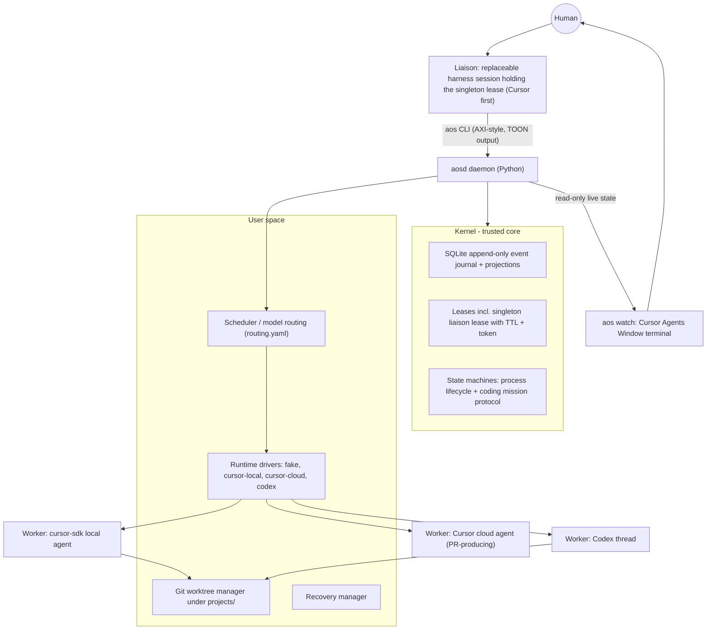

# aOS Proof of Concept

## What we're building

A harness-agnostic control plane implementing the Agent OS Foundations document at **assurance level 1 (cooperative)**. Any harness that can invoke the `aos` CLI and follow the liaison protocol can become the **liaison**; Cursor is simply the first liaison UI for the PoC. Unlike firstmate, all durable state and kernel-enforced authority lives in a Python kernel, not in the harness's context. Workers run in isolated git worktrees under `projects/`. The 0.1 implementation supports the authenticated Cursor and Codex CLIs plus an opt-in official Cursor Python SDK transport; a future Codex SDK bridge must use an officially supported surface rather than the nonexistent Python package assumed in the original draft.

> **Implementation note (2026-07-21):** this document is the target roadmap and evaluation design,
> not a claim that every milestone has shipped. The implementation-status table in `README.md` is
> authoritative for the current release. The durable kernel, fake backend, local Cursor/Codex CLI
> adapters, optional Cursor Python SDK transport, worktrees, verification gate, watch UI, rules,
> and public documentation are implemented. Durable retry levels, non-convergence, provider event
> streaming, health-aware fallback, and restart reconstruction are also implemented. Cloud agents,
> automatic quota accounting, durable Codex Goals, and vendor-session resume remain roadmap work.

The human converses with the liaison as the control surface. In Cursor, the primary PoC surface is the **Agents Window**: after claiming the liaison lease, the liaison opens `aos watch` in a dedicated long-running agent terminal that can be focused or tiled beside the conversation. The liaison still synchronizes with the kernel before every user-facing turn so its decisions use current state, but it only interrupts the conversation for significant changes, blockers, failures, or work ready for approval. Full worker transcripts remain available for drill-down but do not flood the liaison's context.



## Key design decisions

- **The liaison is a portable role; exclusivity is kernel-enforced.** `aos liaison claim --harness <name>` performs an atomic SQLite transaction: insert the singleton liaison lease only if absent or expired (TTL ~10 min). On success it returns a secret token; the database stores only its hash. Every privileged command (`dispatch`, `mission authorize`, `approve`, `signal`) requires the token and renews the lease. A second Cursor window, Codex task, or other harness receives a definitive denial with holder info and expiry.
- **Harness-native delegation is outside the governed path.** All mission work must start through `aos dispatch`; Cursor `/multitask` and Codex subagents must not independently perform mission work. Because this PoC is assurance level 1, this boundary is cooperative rather than a hard security boundary. A root `AGENTS.md`, an always-applied `.cursor/rules/aos-liaison.mdc`, and `.codex/config.toml` with Codex multi-agent tools disabled make the boundary explicit from M1. These rules never receive the liaison token. `aos doctor` validates that the guardrails and backend authentication are present.
- **Canonical state is the journal, not RAM or any vendor session.** Mission Contracts (immutable revisions), Mission Instances, Attempts, Agent Processes, Worker Sessions, Leases, checkpoints, routing decisions, subscription snapshots, liaison inbox cursors, and Events live in `state/aos.db`. Cursor agent IDs and Codex thread IDs are recorded on Worker Sessions as replaceable handles; killing a worker or restarting `aosd` never destroys mission state.
- **A context membrane protects both liaison and worker context.** Workers receive a versioned, curated Work Order rather than the liaison's raw conversation. The Work Order contains the objective, approved constraints and decisions, success predicates, relevant references, budget, backend allowances, and required output contract. Workers return semantic checkpoints and structured completion reports; raw SDK streams are retained as artifacts for inspection.
- **The liaison has an explicit synchronization contract.** Before every user-facing turn it runs `aos liaison sync --since <cursor>` (or the equivalent daemon call). It reports significant changes and attention items rather than repeating routine progress already visible in `aos watch`. `aos inbox` exposes unread attention items, while `aos briefing` reconstructs the full operational picture after compaction, restart, lease transfer, or a switch to another harness.
- **`aos watch` is the primary Cursor oversight UI.** After claiming the lease, the Cursor liaison starts `uv run aos watch` through its terminal tool and leaves it running in a dedicated Agents Window terminal. The command is read-only, needs no liaison token, renders the current durable state even when `aosd` is down, reconnects across daemon restarts, refreshes on meaningful changes, and emphasizes `attention`, `critical`, and `approval` events. Cursor hooks do not have to manipulate UI panes: `AGENTS.md` and the always-applied Cursor rule instruct the liaison to create the visible terminal. A `/aos-watch` Cursor command and an editor workspace task are fallbacks.
- **Daemon + CLI split.** `aosd` (long-running, asyncio) supervises workers, streams normalized driver events into the journal, sweeps expired leases, and marks orphaned processes. The `aos` CLI talks to it over a Unix domain socket; read-only commands fall back to reading SQLite directly if the daemon is down.
- **Retry levels are explicit** per the document: new Worker Session vs. new Agent Process vs. new Attempt are distinct operations with distinct journal events.
- **Routing is capability- and policy-driven.** Drivers expose available model IDs, runtime capabilities, per-run usage, and provider health. Cursor first-party models (initially Composer and Grok) are normal routing candidates. Anthropic models are ineligible by default and may be selected only when the liaison explicitly requests them in the Mission Contract or an authorized routing policy allows them. Model IDs are discovered at runtime rather than assumed stable.
- **Subscription awareness is honest about provider limits.** Codex app-server rate-limit/credit snapshots and reset notifications can be treated as authoritative. Cursor SDK per-run token usage is journaled, but an individual Cursor subscription has no supported public remaining-balance API; aOS uses an estimated local ledger plus provider throttling/errors and never scrapes private dashboard endpoints. Every quota snapshot carries a source, observation time, and confidence (`authoritative`, `estimated`, or `unknown`).
- **Codex Goals are a future execution primitive, not canonical mission state.** If an officially supported external surface exposes them, a later Codex driver may create a persistent Goal with an objective and token budget, ingest Goal state (`active`, `paused`, `blocked`, `usageLimited`, `budgetLimited`, `complete`), and resume the same thread when appropriate. The 0.1 local CLI adapter does not expose Goals. The aOS Mission remains the source of truth; a future Codex Goal would belong to one Agent Process and could not approve, deliver, or create retry levels by itself.
- **AXI principles applied to the `aos` CLI itself**: TOON output, `count:` aggregates, definitive empty states, `help[]` next-step lines after every output, no-args shows a live dashboard (liaison status, active missions, running processes), no interactive prompts, exit 0/1/2 with fail-loud unknown flags.

## Repository layout

```
aOS/
├── AGENTS.md                # liaison protocol: claim lease at start, how to run missions
├── .cursor/rules/
│   └── aos-liaison.mdc      # always-applied Cursor liaison/delegation boundary
├── .cursor/commands/
│   └── aos-watch.md         # one-command fallback to open the Agents Window watch terminal
├── .codex/
│   └── config.toml          # project Codex settings; native multi-agent disabled
├── .vscode/
│   └── tasks.json           # editor fallback: auto-run aOS Watch in a dedicated terminal
├── pyproject.toml           # uv-managed; optional cursor-sdk transport
├── README.md
├── aos/
│   ├── kernel/
│   │   ├── journal.py       # append-only events + projection tables (SQLite, WAL)
│   │   ├── objects.py       # Contract, Mission, Attempt, Process, Session, Lease, WorkOrder, Checkpoint
│   │   ├── machines.py      # process lifecycle FSM + coding mission protocol FSM
│   │   └── leases.py        # atomic claim/renew/expire; liaison singleton
│   ├── daemon.py            # aosd: UDS server, worker supervision, sweeps, recovery
│   ├── scheduler.py         # capability, policy, health, and subscription-aware routing
│   ├── worktrees.py         # clone under projects/, worktree per attempt
│   ├── drivers/
│   │   ├── base.py          # runtime interface: models, quota/health, usage, spawn/resume/signal
│   │   ├── fake.py          # deterministic driver for acceptance tests
│   │   ├── cursor_local.py  # cursor-sdk AsyncClient/AsyncAgent
│   │   ├── cursor_cloud.py  # cursor-sdk cloud, auto_create_pr, bc- IDs
│   │   └── codex.py         # authenticated Codex CLI; official TypeScript SDK bridge later
│   └── cli/
│       ├── main.py          # argparse-based `aos` entrypoint
│       └── toon.py          # TOON serializer + help[] rendering
├── config/routing.yaml      # task kind -> ordered backend/model candidates
├── projects/                # gitignored external clones
├── state/                   # gitignored: aos.db, artifacts/, daemon socket
└── tests/test_acceptance.py
```

## Durable state, live state, and recovery

The kernel deliberately separates canonical state from live runtime machinery:

- **SQLite (`state/aos.db`, WAL):** append-only journal plus rebuildable projections for missions, attempts, processes, worker sessions, leases, Work Orders, checkpoints, claims, evidence, routing decisions, subscription observations, and liaison inbox cursors. Secret liaison/process tokens are stored only as hashes.
- **Filesystem (`state/artifacts/`):** large raw SDK event streams, transcripts, logs, test output, screenshots, and other content-addressed artifacts. SQLite stores references and hashes.
- **Git (`projects/`):** registered external clones, isolated worktrees, branches, commits, and diffs.
- **Vendor state:** Cursor agent/run IDs and Codex thread/Goal IDs are persisted as replaceable Worker Session handles, never as canonical mission state.
- **RAM only:** live SDK clients, subprocess handles, stream/WebSocket connections, cancellation events, timers, and small caches.

After an `aosd` restart, the daemon opens SQLite, rebuilds projections, finds processes that were running, checks their leases and vendor handles, and either safely resumes/reconnects or marks them orphaned. Recovery then performs an explicit new Worker Session, Agent Process, or Attempt according to policy. Expired process authority rejects late zombie-worker events.

## Context, awareness, and human control

Every worker receives a Work Order revision before spawn. Conversational facts matter only after the liaison promotes them into the Mission Contract or Work Order; raw liaison chat is not silently inherited by workers.

Workers use a narrowly scoped process token to renew their lease and emit semantic checkpoints for their own process only:

```
started → plan_ready → implementing → verifying → completed
                            ↘ blocked / failed / cancelled
```

A checkpoint contains `phase`, `completed`, `current`, `next`, `files_touched`, `verification`, and an optional `blocker` or question. Drivers also normalize SDK lifecycle/tool events, but routine tool chatter stays out of the liaison context.

The kernel classifies liaison-facing events as:

- `info`: routine progress, included in the next digest
- `attention`: a worker is blocked or needs a decision
- `critical`: repeated failure, lost process, exhausted budget/quota, or policy violation
- `approval`: verified work is ready for human review

The liaison uses natural-language requests as the human control surface and translates them into authorized commands: show all work, inspect a mission/diff/transcript, explain a routing decision, pause/resume/cancel a process, prevent a retry, change the allowed backend/model, or approve delivery. Workers cannot authorize missions, approve results, merge/deliver work, or control other missions.

`aos watch` continuously renders a compact flight board similar to:

```
aOS: active=2 blocked=1 awaiting_approval=1
M-104 implementing cursor/grok summary="Adding auth endpoints" files_touched=7
M-105 verifying codex/gpt-5.6-sol goal=true tests="38/42 passing"
M-106 blocked cursor/composer question="SQLite only or PostgreSQL too?"
```

When nothing changed, the display remains stable rather than producing scrolling noise. Raw detail is always available through `aos mission view`, `aos events`, and artifact references. In conversation, the liaison leads with new `attention`, `critical`, and `approval` items and otherwise answers the human's request without restating the whole board.

## Cursor Agents Window operation

The Agents Window is the primary liaison experience for the PoC. Its startup contract is:

1. Read `AGENTS.md` and the always-applied `.cursor/rules/aos-liaison.mdc`.
2. Claim the singleton liaison lease.
3. Start `uv run aos watch` using the Cursor terminal tool as a dedicated long-running command.
4. Leave the command running in the background; do not await or terminate it.
5. Reuse the existing watch terminal within the same liaison session rather than starting duplicates.
6. Tell the human that the terminal is available to focus, tile, or expand beside the liaison conversation.

There is no dependency on a Cursor hook being able to open or pin a visible terminal. Hooks may later audit session/subagent lifecycle, but the visible terminal is created by the liaison's normal shell tool. If startup instructions are missed, the human can invoke `/aos-watch`; in the traditional editor, `.vscode/tasks.json` provides a `runOn: folderOpen` fallback with a dedicated, non-focused terminal.

`aos watch` must:

- start before `aosd` and show a definitive empty/offline state from SQLite
- reconnect automatically when `aosd` starts or restarts
- show every registered mission, Agent Process, Worker Session, backend/model, routing reason, latest checkpoint, and attention state
- make blocked work, policy failures, and approval requests visually prominent
- avoid printing raw tool traffic or unchanged periodic heartbeats
- require no secret token and perform no writes

## Model and subscription routing

Routing applies hard constraints first (authorized backend/model, runtime, isolation, goal support, health, and quota availability), then scores eligible candidates for task fit, latency, cost/usage pressure, and policy preference. The chosen candidate and rejected alternatives are journaled with a human-readable reason.

Initial policy hypotheses, to be tuned through real missions rather than treated as permanent model truth:

- Cursor Composer: fast exploration, repository mapping, and tight feedback loops.
- Cursor Grok: fast implementation and broader Cursor-hosted work.
- Codex GPT-5.6 Sol: complex, ambiguous, or high-value work; optionally a persistent Goal for long-running tasks.
- Other Codex models: narrower or high-volume work when policy prefers them.
- Anthropic through Cursor: deny by default; allow only by explicit liaison request in the authorized Mission Contract or a named routing policy.

The scheduler consumes driver-provided model catalogs and does not hardcode mutable provider model slugs. A provider becoming unavailable or usage-limited can cause fallback to the next eligible candidate, but it never expands the Mission Contract's allowed backends/models.

## The mission flow (coding protocol)

```
draft → authorized → dispatched → implementing → verifying → awaiting_approval → delivered
                                      ↘ failed / cancelled / non_convergent
```

1. Human asks the liaison for work. Liaison runs `aos mission create --project <name> --objective "..."` producing a Contract Revision (objective, success predicates, budget ceiling, allowed backends) shown to the human.
2. Human says go → `aos mission authorize <id> --token ...` (records the human Principal via the liaison).
3. `aos dispatch <id> --kind implement` → scheduler applies the authorized routing policy to live model capabilities, provider health, and subscription observations. The kernel journals the routing reason, creates Attempt + Agent Process + versioned Work Order, and the driver spawns the worker in a fresh worktree. Long-running Codex work may attach a Goal to the Worker Session.
4. Worker checkpoints and normalized driver events update journal projections. The liaison runs `aos liaison sync` before each user-facing turn and observes through the dashboard, flight board, inbox, mission view, or detailed events/artifacts. Attention items are prominent; routine tool chatter is not.
5. Worker completion records artifacts (branch, diff stat, structured final response) and a Claim; a basic evaluator runs the contract's test command in the worktree and records Evidence; transition to `awaiting_approval`.
6. Human approves via liaison → `delivered` (local branch ready to merge, or PR link for cloud workers).

## Acceptance experiments

Automated tests use the fake driver wherever possible; provider/UI-specific cases are integration experiments.

1. Second `liaison claim` while lease active is denied; after TTL expiry it succeeds.
2. Privileged command without a valid liaison token is rejected (exit 1, structured error).
3. Illegal mission protocol transition (e.g. draft → delivered) is rejected.
4. Killing a Worker Session does not destroy Mission Instance state; recovery creates a new Agent Process on a different (fake) backend from canonical state, journaled at the correct retry level.
5. Expired process lease revokes future authority (late events from a zombie worker are rejected).
6. Repeated failing attempts trip a simple non-convergence counter → mission enters `non_convergent` instead of retrying forever.
7. `liaison sync` returns only significant unread changes since its event cursor; `briefing` reconstructs all active work and pending human attention from durable state after restart; `watch` renders the same projections without consuming the liaison inbox cursor.
8. A dispatched worker receives a versioned Work Order and can checkpoint only its own Agent Process with its scoped process token.
9. The scheduler journals the selected backend/model and reason; Anthropic is rejected unless explicitly authorized by the Mission Contract or a named policy.
10. A quota-limited or unhealthy fake backend falls through to the next authorized candidate without expanding mission authority.
11. Codex integration maps Goal updates and rate-limit snapshots into Worker Session/process checkpoints while leaving the aOS Mission canonical.
12. From Cursor's Agents Window, the liaison opens one persistent `aos watch` terminal, dispatches a Cursor worker and a Codex worker, and the terminal shows both without requiring either vendor session to be canonical.

## Evaluation strategy

The PoC is evaluated primarily as a control plane, not as a leaderboard for model coding quality. The central question is whether one human, through a replaceable liaison, can understand and govern concurrent work across Cursor and Codex without losing context or authority.

| Hypothesis | Experiment | Pass condition |
| --- | --- | --- |
| Cross-runtime dispatch | From a Cursor liaison conversation, dispatch one Cursor worker and one Codex worker concurrently | Both are registered before spawn, isolated in separate worktrees, and visible together in `aos watch` |
| Human awareness | Ask what every worker is doing at several lifecycle points | Watch/liaison agree on model, phase, last checkpoint, blocker, and pending approval |
| Proactive attention | Cause a worker to request a product decision | The event is prominent in watch and the liaison leads with it on the next turn |
| Authority control | Have a worker attempt to authorize, approve, deliver, or control another mission | Kernel rejects every attempt and journals the denial |
| Delegation boundary | Attempt native Cursor/Codex delegation for mission work | Guardrail denies it or records a clear policy violation; no unregistered worker is treated as governed |
| Routing policy | Submit exploration, fast implementation, and complex/long work | Eligible Composer/Grok/Sol routes are chosen with reasons; Anthropic remains denied unless explicitly authorized |
| Durable recovery | Kill `aosd` while both workers are active | Restart reconstructs missions, attempts, processes, sessions, worktrees, checkpoints, and attention state |
| Retry semantics | Kill a worker and later submit a zombie event | Recovery uses the correct Session/Process/Attempt level and rejects expired authority |
| Isolation | Let both workers operate on the same external repository | Registered worktrees prevent overwrites or shared working-copy corruption |
| Context membrane | Give the liaison important conversational constraints, then compact or replace the liaison session | Approved constraints survive in the Contract/Work Order; raw chat is neither required nor indiscriminately copied |
| Evidence integrity | Make a worker claim completion while verification still fails | Evaluator records contrary evidence and prevents `awaiting_approval`/delivery |
| Non-convergence | Force repeated failing approaches | Mission enters `non_convergent` instead of retrying indefinitely |
| Secret handling | Inspect DB, artifacts, logs, and worker inputs | No plaintext liaison token leaks; process authority remains scoped |
| Operational UX | Use only Cursor Agents Window conversation plus `aos watch` | Human can quickly answer what is running, blocked, failed/recovered, and ready for approval |

### Final dogfood scenario

1. Open Cursor Agents Window in the aOS repo; claim the liaison lease and automatically start the watch terminal.
2. Authorize two missions against the same external test repository.
3. Dispatch exploration/fast work to a Cursor model and complex implementation to Codex Sol using a Goal.
4. Observe both workers concurrently in the tiled `aos watch` terminal.
5. Force one worker to block on a product decision; answer through the liaison and resume it.
6. Kill `aosd` and one worker; restart and demonstrate durable reconstruction plus correct retry/resume behavior.
7. Attempt an unauthorized Anthropic route and a harness-native subagent; demonstrate policy handling.
8. Force one false completion claim; show that independent verification prevents delivery.
9. Complete verification, inspect diffs/evidence, and approve both missions through the liaison.
10. Let the lease expire or release it, claim from another compatible harness, and reconstruct the same operational picture with `aos briefing`.

The human-facing success criterion is that, at any point in this scenario, the Cursor Agents Window makes it obvious: what is running, who/model is doing it, why it was routed there, what changed, what is blocked, what needs a decision, what recovered, and what is ready for approval.

## Milestones

- **M1 — Kernel core, CLI, and liaison contract.** Journal, durable objects, FSMs, singleton liaison lease/token hashing, `AGENTS.md`, Cursor/Codex project guardrails, `/aos-watch` and editor-task fallbacks, `aos doctor`, and AXI-style TOON dashboard/sync/briefing/watch empty-state contracts. Acceptance tests 1–3.
- **M2 — Daemon, fake driver, awareness, and recovery.** `aosd`, versioned Work Orders, scoped process tokens, semantic checkpoints, liaison inbox/flight-board projections, live/reconnecting `aos watch`, dispatch end-to-end with the fake driver, sweeps, and recovery manager. Acceptance tests 4–8.
- **M3 — Cursor local driver, worktrees, and routing.** Dynamic Cursor model discovery, Composer/Grok default policy, per-run usage ledger, routing explanations/fallback, and the first real mission against a repo cloned under `projects/`. Acceptance tests 9–10.
- **M4 — Codex driver + Cursor cloud driver.** Codex rate-limit snapshots, persistent Goal integration, model routing across three real backends, and cloud missions ending in PRs. Acceptance test 11.
- **M5 — Documentation, Agents Window integration, and dogfood.** Polish README/liaison guidance, validate the automatic watch-terminal startup in Cursor Agents Window, run the final dogfood scenario through each backend, and demonstrate lease transfer/reconstruction from another compatible liaison harness. Acceptance test 12 and the evaluation matrix above.

## Out of scope for this PoC (explicitly, per the document's non-goals)

Effect brokers and effect authorizations, capability attenuation beyond the liaison/process tokens, evaluator independence certificates, Mission Realm isolation beyond worktrees, hard prevention of harness-native delegation, private/undocumented provider usage APIs, and Pi/Claude drivers. Anthropic models reachable through Cursor are not implemented as a default route; they are policy-gated exceptions. The driver interface and journal schema leave room for higher assurance levels, honestly reported as level 1 for this PoC.

## Notes

- Python 3.11+, `uv` for dependency management. The optional `cursor-sdk` dependency is pinned through `uv.lock`; its API-key billing must not be presented as an IDE subscription allowance. The default Cursor and Codex CLI transports reuse their respective authenticated local sessions. The officially documented Codex SDK is TypeScript; 0.1 uses `codex exec` rather than inventing a Python package. Platform API-key billing is not required by the fake or local CLI paths.
- The `aos` CLI can later be extracted as a standalone AXI (`aos-axi`) usable by any harness; for the PoC it lives in this repo and is invoked as `uv run aos ...` or a console script on PATH.
